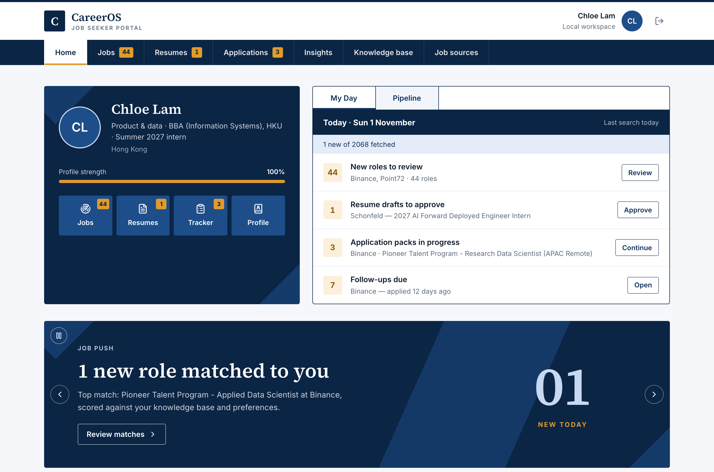
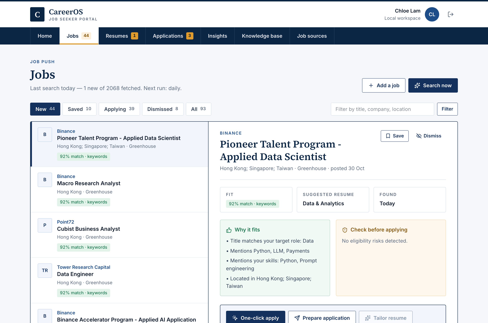
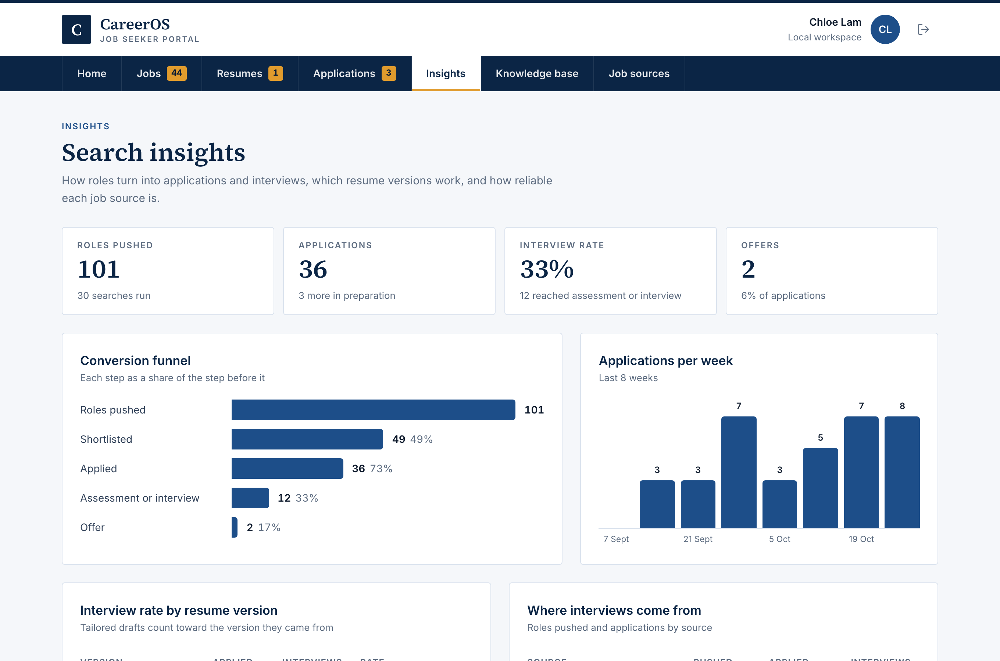
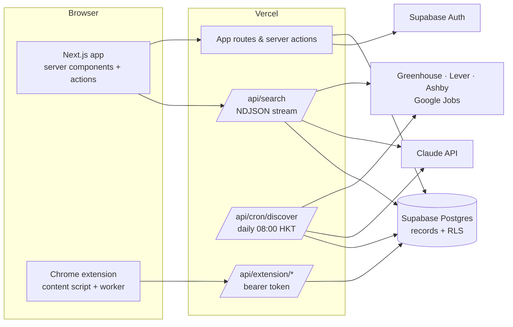

# CareerOS

[](https://github.com/zyaoyu0203-sys/careeros/actions/workflows/ci.yml)

**A job-search portal that runs the busywork for you — and leaves the decisions to you.**
CareerOS searches the job boards you choose every morning, scores each role against your own
experience, picks the right resume version, and fills the employer's application form through a
browser extension. You review it and press Submit; CareerOS records the application and tracks it
to an offer.

Live: <https://careeros-mocha-kappa.vercel.app>



## What it does

| | |
|---|---|
| **Knowledge base** | A seven-step onboarding captures contact details, education, *verifiable* experience facts, skills and the questions every form asks (work rights, sponsorship, start date, salary). Everything else is built from it. |
| **Job push** | Daily search across public ATS boards (Greenhouse, Lever, Ashby) and Google Jobs. Roles are filtered by whole-word title match, location and seniority, de-duplicated, then scored by Claude against the knowledge base — or by a transparent keyword score when AI is unavailable. Manual searches stream live per-board progress. |
| **Resumes** | Versions are views over the knowledge base and are routed to each job automatically. Tailored drafts are rewritten per job from verified facts only and need approval before use. Rendered to PDF on the server. |
| **One-click apply** | Choose a resume → the employer's form opens → the extension fills it and attaches the PDF → **you press Submit** → the confirmation page is detected and the application is recorded with evidence. |
| **Tracker & insights** | Status history per application; a funnel from pushed to offer, interview rate per resume version, and per-board reliability from every recorded search run. |

| Jobs | Insights |
|---|---|
|  |  |

## Architecture



More detail — data model, request flows, failure handling — in [docs/ARCHITECTURE.md](docs/ARCHITECTURE.md).
Key decisions are recorded in [docs/decisions](docs/decisions):

1. [The user always presses Submit](docs/decisions/0001-user-presses-submit.md)
2. [Only official job-board APIs — no LinkedIn scraping](docs/decisions/0002-official-sources-only.md)
3. [One JSON records table behind row-level security](docs/decisions/0003-records-table.md)
4. [Extension auth with hashed personal tokens](docs/decisions/0004-extension-tokens.md)

## Tech

Next.js 15 (App Router, server actions, route handlers) · TypeScript · Tailwind CSS v4 ·
Supabase (Postgres, Auth, row-level security) · Claude API with structured outputs ·
`@react-pdf/renderer` · Chrome Extension MV3 · Vitest · Playwright · GitHub Actions · Vercel (Cron).

## Tests

```bash
npm test            # 50 unit tests: filtering, scoring, routing, insights, autofill mapping, token auth, storage
npm run test:e2e    # Playwright: onboarding → role → application pack → tracker, plus the extension
```

The extension test loads the real unpacked extension into Chromium, serves a Greenhouse-style form
at a `boards.greenhouse.io` URL, and asserts the form is filled, the resume PDF attached, and the
submission recorded back in CareerOS.

## Run locally

```bash
npm install
npm run demo:local   # optional: a fictional demo workspace with live roles
npm run dev
```

Without Supabase variables the app runs in single-user local mode (data in `.data/db.json`),
which refuses to start on Vercel. See `.env.example` for production configuration.

### The extension

Load `extension/` as an unpacked extension in `chrome://extensions`, then add your CareerOS
address and a token from **Job sources → Browser extension**.
